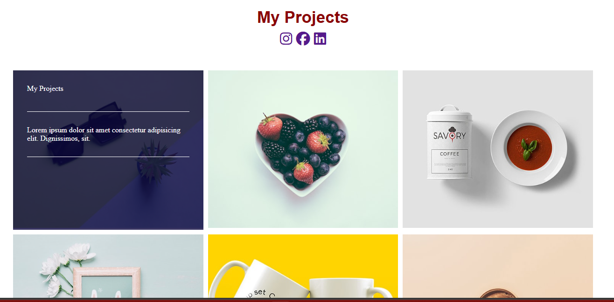

# Portfolio Grid Interaction Demo

A lightweight HTML5/CSS3 image-card grid with sliding descriptions on hover and keyboard focus. The original six images and dark overlays are preserved. Cards are sample content, not links to published projects.

The existing screenshot shows the original desktop design; keyboard access, mobile columns and touch descriptions have since been improved.

## Run

Open `index.html`, or run `python -m http.server 8775` and visit http://localhost:8775. `Task9.html` remains as a compatible entry point with the same content. There are no external fonts, icon kits, npm dependencies or build step.

## Interaction and layout

CSS Grid uses three desktop columns, two below 992px, and one below 601px. `minmax(0,1fr)` allows tracks to shrink. Each semantic `article` can receive keyboard focus: Tab reveals the same description as hover, with a visible outline. On coarse-pointer or non-hover devices, descriptions are displayed below images permanently. Reduced-motion preference removes the sliding transition. Overlay content can scroll if the text is longer than the image.

Customize card headings, descriptions and image alt text in both entry files; change breakpoints or overlay colors in `Task9.css`. Images load lazily with asynchronous decoding. Empty social links and their unused external icon kit were removed rather than representing nonexistent profiles.

## Validation and hosting

`python scripts/check.py` validates local assets, in-page references, semantic card count and matching entry pages. GitHub Actions executes it. Browser rendering and narrow viewport checks are included in the portfolio report. No artificial unit tests were added for static CSS.

Ready for GitHub Pages with `index.html`; no verified public demo is configured. Limitations: no project-detail links, image provenance is not documented in the original repository, and the sample images have general alt descriptions. Replace them with owned/licensed images and descriptive context before commercial reuse.

Author: Shazeel Ahmed. No license file is present.
